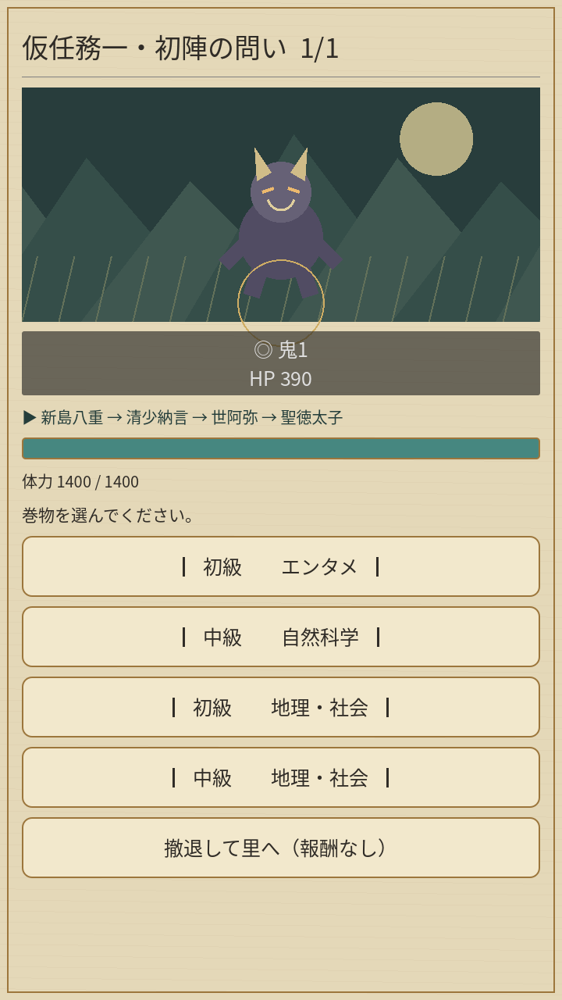
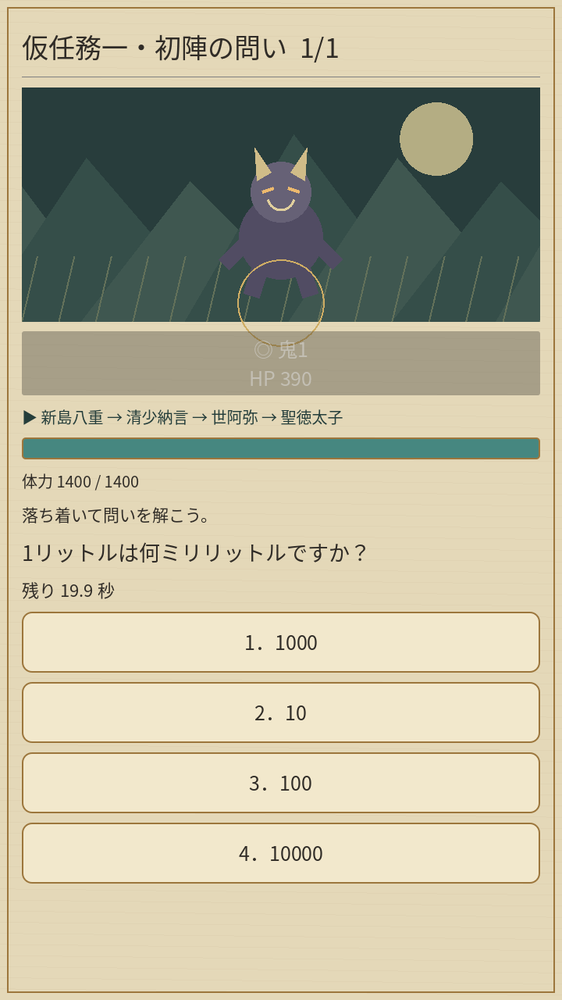

# 画面比較・実装前設計

2026-11-17。実装開始前の設計。資料はRESEARCH.mdのS1〜S8で特定。原作画像自体は配布しない。以下の比率は目視の概算でありピクセル測定値ではない。

## 戦闘レイアウト比較
参照：[S1 SS004](https://www.4gamer.net/games/252/G025268/20140819084/SS/004.jpg)、[SS005](https://www.4gamer.net/games/252/G025268/20140819084/SS/005.jpg)、[大型鬼 SS007](https://www.4gamer.net/games/252/G025268/20140819084/SS/007.jpg)。

|原作で見えた構成|制作する配置（720×1280）|相違・段階|
|---|---|---|
|縦画面、敵・背景は上半分弱|上端安全域、戦場y=70〜530|背景・鬼は独自の仮図形。画面比は約9:16として開始。|
|右上メニュー、左上通貨・属性図|戦場上に任務名・撤退、属性表記|相性方向未確認のため矢印を捏造しない。|
|複数小型鬼の横並び、大型鬼は画面を占有|戦場内で敵を横並び。Phase 2で部位別ターゲット|Phase 1は小型鬼のみ。|
|行動者の大きな顔と後続の小さな顔、右の橙色円|戦場下に4体の行動列とHP、その右に将来の専用技欄|独自仮肖像。Phase 1で特殊技ボタンは置かない。|
|HP横長、ポイント小表示|共有HP横長、戦闘ログ|ポイントはPhase 2。|
|下半分に巻物4本、難易度が左、ジャンル中央|縦4本の横長巻物。初/中/上級とジャンル|一般正解率は自作問題に統計がないので表示しない。|
|回答時は問題文＋時間線＋縦4択|下半分を問題文・時間・4つの回答に切替|原作文言・枠絵をコピーしない。|
|攻撃・ハヤフリ・技にカットイン|Phase 1は正誤と攻撃の短い遷移、Phase 2で専用カットイン|現在の仮時間は測定結果ではない。|

## 必要画面ごとの比較計画
|画面|原作参照・確度|予定構成と段階|
|---|---|---|
|タイトル|S1 SS001は紹介イラスト。タイトルUIとは断定しない(C)|独自題字・開始・非公式/仮実装表示。P1。|
|導入・チュートリアル|S2初期ミタマ選択(B)、全導線はC|巻物選択→四択→攻撃を段階説明。P3以降。|
|里|今回のホーム画像未確認(C)|和紙背景、通貨と任務導線、下部メニューを段階追加。P1。|
|領域|S1 SS002(A)|縦地図と領域札。初期は「試作領域」と明示。P1簡易版/P4。|
|任務選択|S2本文(B)、詳細配置C|巻物状の任務一覧。仮任務と報酬、解放条件。P1。|
|任務詳細|未確認(C)|出現鬼・行動力・報酬・出陣。P1。|
|編成|S1 SS003(A)|4体を横並び、コスト・合計体力・能力一覧。P1固定確認/P3交換。|
|ミタマ一覧/詳細|S2本文(B)、詳細配置C|仮肖像中心、能力値・技・出典確度。P3。|
|強化/進化|S2本文(B)、配置C|素材・ハクと強化前後の比較、確定操作。P3。|
|事典|S2本文(B)、配置C|取得状態、登録数、達成報酬。P3。|
|通常戦闘|S1 SS004〜008(A)|上記。P1/P2。|
|ムスヒノ刻|S1 SS010カットイン(A)、回答配置C|専用画面・タイマー・○×・正答数・誤答数。P2。|
|任務結果|S2達成記述(B)、配置C|勝敗・正解数・報酬・帰還。P1。|
|ガチャ|S2天狐演出の記述(B)、外観使用不可|独自の封印開放演出、無料通貨のみ。P3。|
|修練|S4(C)|正答率・討伐数の自己ベスト、ローカルNPC比較。P3。|
|設定/セーブ管理|未確認(C)|音量・自由プレイ・バックアップ入出力。P1基本保存/P3管理画面。|

## 初期ワイヤー
```
┌─────────────────┐
│ 任務名          撤退 │
│                     │
│    鬼   鬼   鬼     │
│                     │
├─────────────────┤
│ 行動者 → 後続３体   │
│ HP ━━━━━━━━━━━━ │
├─────────────────┤
│ [初級] 生活  巻物  │
│ [中級] 歴史  巻物  │
│ [初級] 自然科学    │
│ [上級] スポーツ    │
└─────────────────┘
```
巻物選択後は下半分を問題文・時計・縦4択に置換。情報の順序を守り、カードの格子へ置き換えない。

## 検証方法
P1は720×1280のレンダーと入力テスト。P4で原作画像との対比表を更新する。Pixel 6aの1080×2400は縦に長いため、canvas_itemsのexpandとセーフエリアを用い、実画面サイズで上下の欠け・ボタン最小寸法・システムバー重なりを検証する。実機未接続を検証済みとはしない。

## Phase 1実画面（実装後の追記）
独自に実装した画面。原作画面とは異なり、人物イラスト・追撃・専用技・部位破壊は未実装。

|巻物選択|四択回答|
|---|---|
|||

原作と同じ「上部に鬼・中段に行動列とHP・下部に巻物または回答」という順序で実装。原作の細かな軸装飾や肖像列、原作画像の迫力は再現途上。ゲーム内の仮鬼は新規の簡易図形であり、最終素材ではない。
